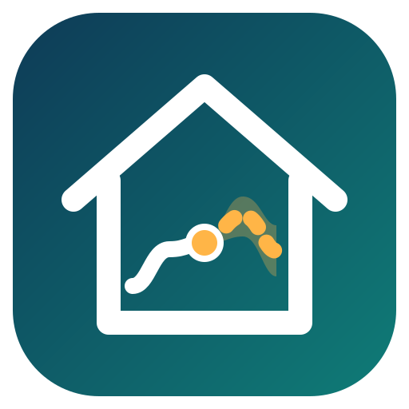

# LoadCast

**Household load forecasting for Home Assistant** – learned from your own
history, temperature-aware, and honest about its own accuracy.

LoadCast does for consumption what Solcast does for solar: it publishes a
24–48 h forecast of how much electricity your home will use, so battery
planners, EV schedulers and other automations can make better decisions.
It never controls anything itself.

> Status: design phase – see [SPEC.md](SPEC.md).

## Why

Most home-energy automations estimate future consumption with fixed constants
or hand-tuned regressions. They drift silently when the house changes – a heat
pump fails, the pool closes for the season – and the resulting plans buy
energy that is never needed. LoadCast learns the real profile continuously,
per sub-load, and adapts in both directions.

## Planned features

- Learns from recorder statistics – no model parameters to tune
- Separate models for sub-loads (heat pump, EV charger, pool …)
- Outdoor temperature + weather forecast aware
- P10/P90 uncertainty band
- Solcast-style `forecast` attribute and a `loadcast.get_forecast` service
- Daily forecast-vs-actual accuracy sensors
- Native integration: works on Container, Core and OS installs

## Installation

Can be added to HACS as a custom repository (type *Integration*), but the
current version is an empty skeleton – it installs cleanly and does nothing
until the first functional release.

## License

MIT – see [LICENSE](LICENSE).
